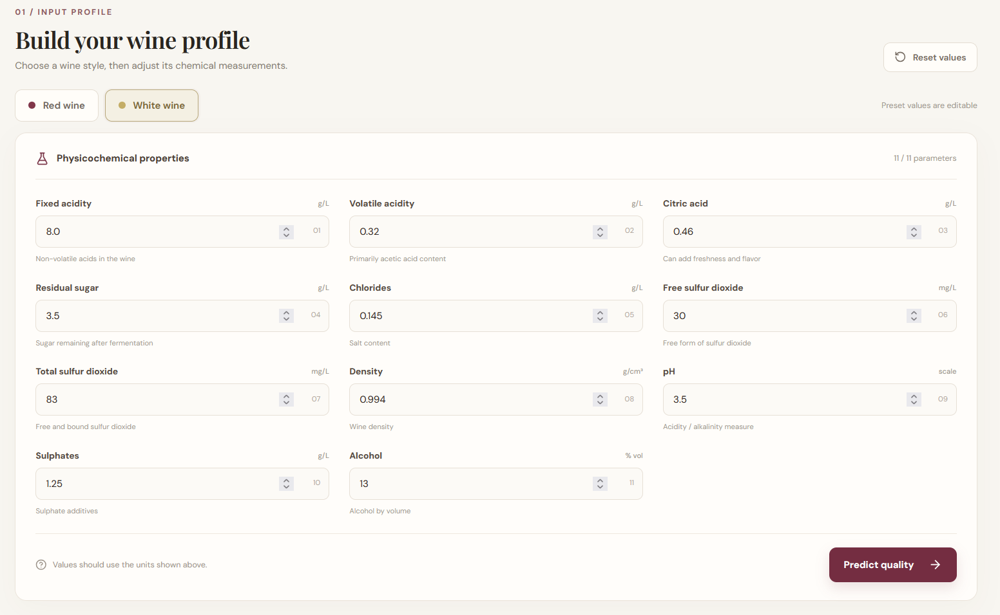
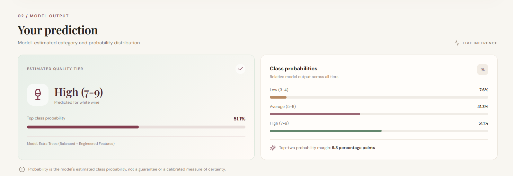

# WineSense AI — Intelligent Wine Quality Prediction

WineSense AI is a machine-learning-powered web application that estimates a wine's quality category from its physicochemical properties. Users can select red or white wine, enter the wine's chemical measurements, and receive a predicted quality tier with a probability distribution for the three categories.

## Features

- **Red and white wine profiles** with selectable wine type.
- **11 physicochemical input parameters**:
  - Fixed acidity
  - Volatile acidity
  - Citric acid
  - Residual sugar
  - Chlorides
  - Free sulfur dioxide
  - Total sulfur dioxide
  - Density
  - pH
  - Sulphates
  - Alcohol
- **Three quality tiers**:
  - Low (3–4)
  - Average (5–6)
  - High (7–9)
- **Model probability breakdown** for all three quality tiers.
- **Prediction insights**, including the top-class probability and top-two probability margin.
- **FastAPI backend** for serving model predictions.
- **Interactive API documentation** through Swagger UI.

## Application Screenshots

### 1. Wine input profile

Choose a wine type and enter its physicochemical measurements. The input form provides editable values for all 11 parameters.



### 2. Prediction results

The results view displays the estimated quality tier, the model's top-class probability, and the probability distribution across Low, Average, and High categories.



## Technology Stack

| Layer | Technology |
|---|---|
| Frontend | React, TypeScript, Vite |
| Backend | Python, FastAPI |
| Machine learning | Scikit-learn, Extra Trees |
| API validation | Pydantic |
| API testing/documentation | Swagger UI (OpenAPI) |

## How the Application Works

1. Select **Red wine** or **White wine**.
2. Enter the 11 physicochemical measurements using the units shown in the interface.
3. Select **Predict quality**.
4. The frontend sends the input data to the backend prediction endpoint.
5. The backend validates the request and passes the measurements to the trained Extra Trees model.
6. The application displays the predicted quality tier and class probabilities.

The displayed probabilities are model-estimated values. They are not guarantees of wine quality or necessarily calibrated measures of certainty.

## Run Locally

### Prerequisites

- Python 3.10 or a compatible version
- Node.js and npm
- Git

### 1. Clone the repository

```bash
git clone https://github.com/YOUR_USERNAME/YOUR_REPOSITORY.git
cd YOUR_REPOSITORY
```

Replace the repository URL with your GitHub repository URL.

### 2. Start the FastAPI backend

Open a terminal and navigate to the backend directory:

```bash
cd backend
```

Create and activate a virtual environment.

**Windows PowerShell:**

```powershell
python -m venv .venv
.venv\Scripts\Activate.ps1
```

Install the backend dependencies:

```powershell
pip install -r requirements.txt
```

Start the API from the `backend` directory:

```powershell
uvicorn app.main:app --reload
```

The API should be available at:

```text
http://127.0.0.1:8000
```

### 3. Open Swagger UI

With the backend running, open:

```text
http://127.0.0.1:8000/docs
```

Swagger UI provides an interactive way to inspect and test the API endpoints.

### 4. Start the frontend

Open a **second terminal** at the project root. Navigate to the frontend directory (if it is named `frontend`):

```bash
cd frontend
npm install
npm run dev
```

Open the local URL printed by Vite, commonly:

```text
http://localhost:5173
```

> Keep both the backend and frontend terminals running while using the application. If your project uses a different frontend directory name or environment configuration, follow the paths and settings in your repository.

## Test Predictions with Swagger UI

The prediction endpoint is:

```http
POST /api/predict
```

Full local URL:

```text
http://127.0.0.1:8000/api/predict
```

### Steps

1. Start the FastAPI backend.
2. Open `http://127.0.0.1:8000/docs`.
3. Expand **POST `/api/predict`**.
4. Click **Try it out**.
5. Enter a request body such as the example below.
6. Click **Execute**.
7. Inspect the **Server response** section, including the HTTP status code and JSON response body.

### Example request body

```json
{
  "wine_type": "red",
  "fixed acidity": 7.4,
  "volatile acidity": 0.70,
  "citric acid": 0.00,
  "residual sugar": 1.9,
  "chlorides": 0.076,
  "free sulfur dioxide": 11,
  "total sulfur dioxide": 34,
  "density": 0.9978,
  "pH": 3.51,
  "sulphates": 0.56,
  "alcohol": 9.4
}
```

### Example successful response

The following is an example response returned during local API testing. The predicted values depend on the submitted input and the model artifact being used.

```json
{
  "predicted_class_id": 1,
  "predicted_tier": "Average (5-6)",
  "confidence": 0.815575,
  "top_two_margin": 0.663711,
  "entropy": 0.564004,
  "probabilities": {
    "Low (3-4)": 0.151864,
    "Average (5-6)": 0.815575,
    "High (7-9)": 0.032561
  },
  "model_name": "Extra Trees (Balanced + Engineered Features)",
  "notice": "Probability is the model's estimated class probability, not a guarantee or a calibrated measure of certainty."
}
```

### Understanding the response

| Field | Description |
|---|---|
| `predicted_class_id` | Numeric identifier of the predicted category |
| `predicted_tier` | Human-readable predicted quality category |
| `confidence` | Model-estimated probability for the predicted category |
| `top_two_margin` | Difference between the two highest class probabilities |
| `entropy` | Measure of uncertainty in the class probability distribution |
| `probabilities` | Estimated probabilities for Low, Average, and High categories |
| `model_name` | Name of the model used for inference |
| `notice` | Qualification explaining how to interpret the probability |

### HTTP response codes

- **200 — Successful Response:** The request passed validation and the prediction endpoint returned a response.
- **422 — Validation Error:** The submitted request did not satisfy the API's input schema. Check the response body's `detail` field for the field and validation rule that caused the error.

Use plausible measurement values and the units indicated in the application. Values outside the API's accepted limits may be rejected before model inference.

## API Endpoint

| Method | Endpoint | Purpose |
|---|---|---|
| `POST` | `/api/predict` | Predict a wine quality tier from physicochemical measurements |

Interactive API documentation:

```text
http://127.0.0.1:8000/docs
```

## Project Structure

The following is a simplified view of the application structure. Your actual repository may contain additional files and folders.

```text
winesense-ai/
├── backend/
│   └── app/
│       ├── __init__.py
│       └── main.py
├── frontend/
│   ├── src/
│   ├── public/
│   └── package.json
├── screenshots/
│   ├── wine-input-profile.png
│   └── wine-prediction-result.png
└── README.md
```

## Notes

- The model's output is an estimate based on the submitted measurements and its learned patterns.
- A predicted category should not be treated as a guarantee of sensory quality or a substitute for professional wine evaluation.
- Keep the model artifact, preprocessing logic, and feature order consistent between training and inference.
- Do not commit virtual environments, API secrets, local caches, or other generated files to GitHub.

## License

Add a license file if you intend to distribute or reuse this project publicly. Until a license is added, all rights remain with the copyright holder.
